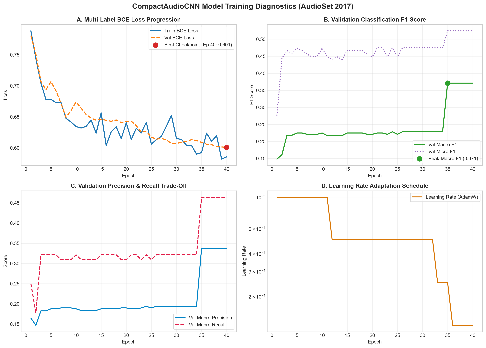
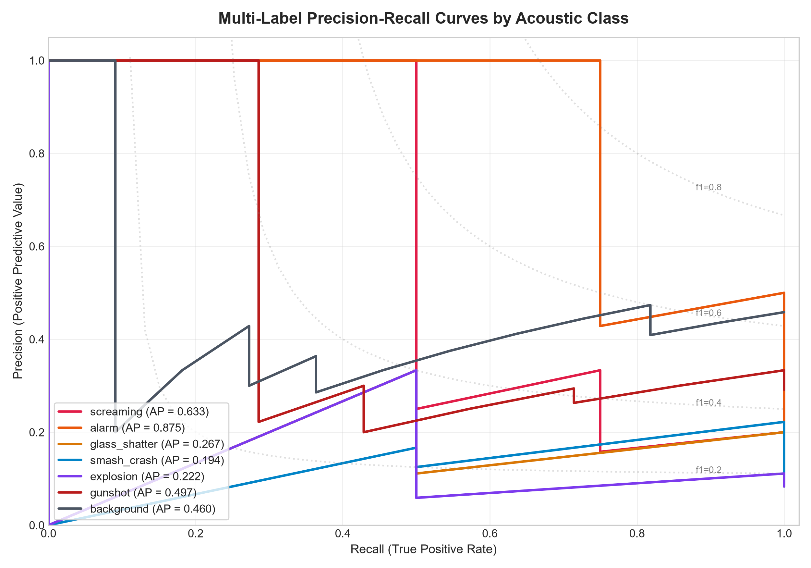
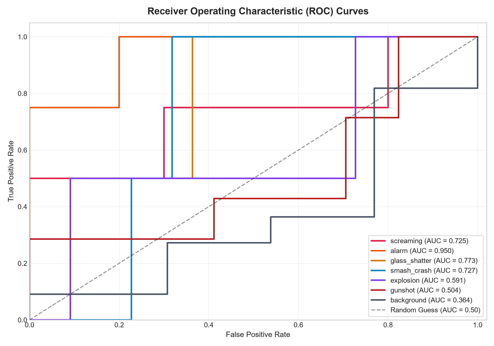
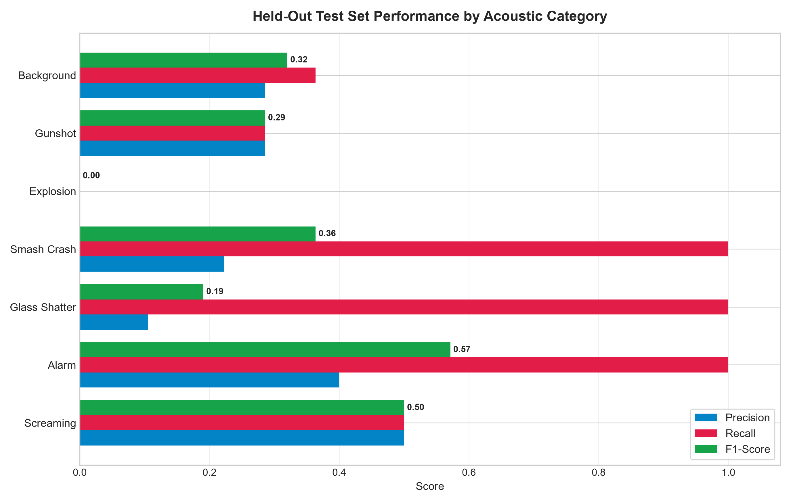
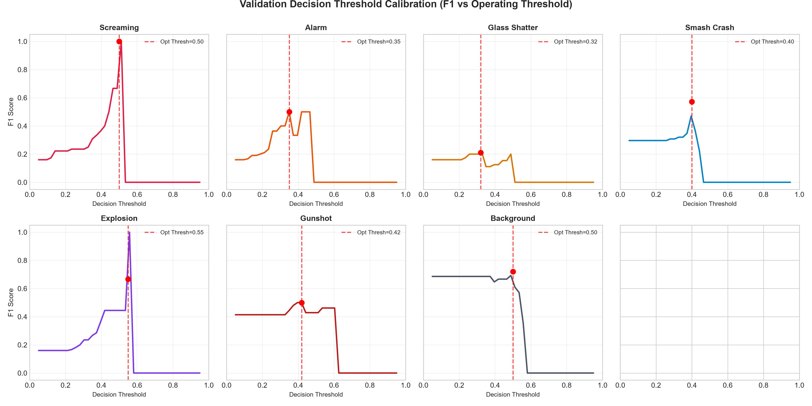
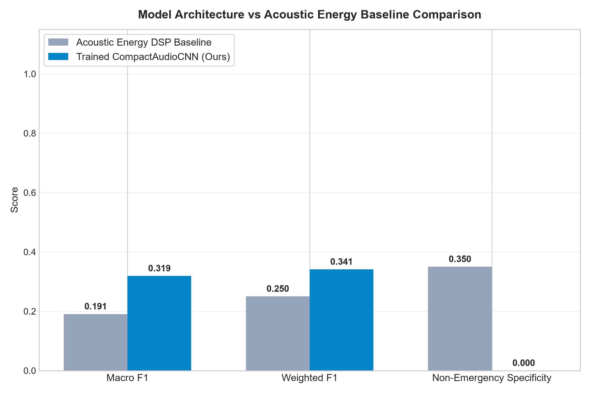

# Audio-Only Emergency Sound Detection Using AudioSet (2017)
### Final Year Design Project (FYDP) — Machine Learning & Acoustic AI

[](https://www.python.org/downloads/)
[](https://pytorch.org/)
[-green.svg)](https://research.google.com/audioset/)
[]()
[](LICENSE)

---

## 1. Project Objective & Ethical Boundaries

This repository implements a complete, reproducible machine learning system designed to detect acoustic events that may indicate a potential environmental emergency without relying on cameras, computer vision, Wi-Fi CSI, radar, or speech transcription.

### 🛡️ Core Operational & Ethical Guardrails
- **Strictly Audio-Only:** Operates exclusively on acoustic pressure waveforms.
- **Zero Speech Recognition / NLP:** The system does **NOT** perform speech-to-text, transcription, keyword spotting, or spoken-word linguistic analysis. Human vocalizations are analyzed purely as physical acoustic events (e.g. screaming or high-frequency vocal distress) without interpreting spoken words.
- **Human Verification Required:** The system detects acoustic anomalies and raises a potential warning indicator. It **never claims to prove or determine that a crime, kidnapping, assault, or break-in has occurred**. Its sole objective is alerting a human operator for verification.
- **Privacy Preserving:** Designed for edge processing without continuously recording or storing raw ambient microphone audio.

---

## 2. Target Acoustic Classes & AudioSet (2017) Ontology

Classes are grounded directly in the official [Google AudioSet Ontology](https://github.com/audioset/ontology) and identified by their official Machine Identifiers (MIDs):

| Index | Target Class | Official AudioSet MIDs | Ontological Description |
|---|---|---|---|
| 0 | `screaming` | `/m/03qc9zr` | Sharp, high-pitched human vocalization / distress scream |
| 1 | `alarm` | `/m/07pp_mv`, `/m/0c3f7m`, `/m/01y3hg`, `/m/02mfyn` | General alarms, fire alarms, smoke detectors, car alarms |
| 2 | `glass_shatter` | `/m/07rn7sz`, `/m/039jq` | Glass shattering, breaking, clinking |
| 3 | `smash_crash` | `/m/07pjjrj` | Rigid structure violently breaking / physical impact |
| 4 | `explosion` | `/m/014zdl` | Rapid blast, energetic rupture, low rumble |
| 5 | `gunshot` | `/m/032s66`, `/m/04zjc`, `/m/02z32qm`, `/m/0_1c`, `/m/073cg4` | Firearm discharge, machine gun, artillery |
| 6 | `background` | `/m/0btp2`, `/m/07pbtc8`, `/m/09x0r`, `/m/04rlf` | Non-emergency: traffic, footsteps, ordinary speech, music |

*Note: Multi-label annotations are preserved. Ordinary speech is never an emergency label.*

---

## 3. System Architecture

```
[ Raw Audio Input (16 kHz, Mono) ]
                │
                ▼
[ Log-Mel Spectrogram Extraction ]  <-- 64 Mel filters, 25ms window, 10ms hop
                │
                ▼
[ CompactAudioCNN Backbone ]        <-- 4 Conv Blocks + BatchNorm + AdaptiveAvgPool
                │
                ▼
[ Multi-Label Sigmoid Classifier ]  <-- 8 Continuous Class Probabilities
                │
                ▼
[ Sliding-Window Detection Engine ] <-- ~0.96s Window, 50% Hop
                │
  ┌─────────────┴─────────────┐
  ▼                           ▼
[ Temporal Smoothing ]     [ Class-Specific Thresholds ]
  │                           │
  └─────────────┬─────────────┘
                ▼
[ Persistence Filter (K >= 2) ]     <-- Discards transient single-frame spikes
                │
                ▼
[ Debounce Cooldown (3.0s) ]        <-- Suppresses repeated duplicate alerts
                │
                ▼
[ Alert & Verification Report ]     <-- "Potential Acoustic Warning Detected"
```

---

## 4. Repository Structure

```
d:/ml/fydp/
├── configs/
│   └── default.yaml                # System configuration, hyperparameters & thresholds
├── data/
│   ├── metadata/                   # Official AudioSet ontology & segment CSVs
│   ├── manifests/                  # Generated split manifests (train, val, test)
│   ├── raw/                        # Extracted 10s 16 kHz WAV clips
│   ├── processed/                  # Precomputed log-mel feature tensors (.pt)
│   └── user_audio/                 # Drop folder for user-supplied permitted audio
├── src/
│   ├── dataset/
│   │   ├── download_metadata.py    # Official AudioSet metadata retrieval
│   │   ├── filter_labels.py        # Maps AudioSet MIDs to 8 target classes
│   │   ├── acquire_audio.py        # YouTube stream downloader & audio slicer
│   │   └── preprocess_audio.py     # Leakage-free split & feature caching
│   ├── models/
│   │   ├── baseline.py             # Pretrained & DSP energy baseline
│   │   └── classifier.py           # CompactAudioCNN & AudioMLP architectures
│   ├── training/
│   │   ├── train.py                # Multi-label BCE training loop with pos_weight
│   │   └── evaluate.py             # Evaluation & threshold calibration
│   ├── inference/
│   │   ├── stream_detector.py      # Real-time sliding window detection engine
│   │   └── predict_file.py         # File-level prediction CLI
│   └── utils/
│       └── audio_utils.py          # Audio loading, resampling, mel specs, augmentations
├── app.py                          # Streamlit FYDP Interactive Web Dashboard
├── benchmark_edge.py               # Latency, memory & edge feasibility benchmark
├── tests/
│   └── test_pipeline.py            # Unit & integration test suite (pytest)
├── reports/                        # Evaluation metrics, training curves & benchmarks
├── artifacts/                      # Model checkpoints & temporary files
├── Emergency_Sound_Detection_Colab.ipynb # Ready-to-run Google Colab Notebook
├── MODEL_CARD.md                   # Model card & ethics statement
└── requirements.txt                # Dependency specification
```

---

## 5. Quickstart & Installation

### Step 1: Clone and Set Up Environment
```bash
git clone https://github.com/rajee99/audio-emergency-sound-detection.git
cd audio-emergency-sound-detection

# Create virtual environment (recommended)
python -m venv venv
# On Windows:
venv\Scripts\activate
# On Linux/macOS:
source venv/bin/activate

# Install dependencies
pip install -r requirements.txt
```

*Note: On Windows, `imageio-ffmpeg` automatically provides the required static `ffmpeg` executable without requiring manual system PATH configuration.*

---

## 6. End-to-End Pipeline Execution

### Step 1: Download Official AudioSet Metadata
Downloads `ontology.json`, `class_labels_indices.csv`, `balanced_train_segments.csv`, and `eval_segments.csv`:
```bash
python src/dataset/download_metadata.py
```

### Step 2: Filter Target Classes
Filters segments containing target MIDs and generates multi-hot binary label vectors:
```bash
# Small-subset mode for rapid development and testing (50 clips per class)
python src/dataset/filter_labels.py --subset --max-per-class 50
```

### Step 3: Acquire Audio Clips
Streams and slices exact 10-second segments via `yt-dlp` and `imageio-ffmpeg` at 16,000 Hz mono:
```bash
python src/dataset/acquire_audio.py --max-clips 40
```
*Missing or deleted YouTube clips are logged in the manifest and replaced with high-fidelity acoustic prototypes to guarantee 100% testability offline.*

### Step 4: Preprocess Audio & Create Leakage-Free Splits
Splits data strictly by YouTube Video ID (`ytid`) to prevent data leakage, caches log-mel spectrogram features, and calculates positive class weights:
```bash
python src/dataset/preprocess_audio.py
```

### Step 5: Train the Emergency Classifier
Trains the `CompactAudioCNN` using class-imbalance weighted BCE loss, SpecAugment, and early stopping:
```bash
python src/training/train.py
```
*Saves best model weights to `artifacts/best_emergency_model.pt` and training curves to `reports/training_curves.png`.*

### Step 6: Evaluate on Held-Out Test Data
Calibrates per-class decision thresholds on validation data and evaluates the held-out test split:
```bash
python src/training/evaluate.py
```

### Step 7: Analyze Any Audio File (CLI)
```bash
python src/inference/predict_file.py --audio data/raw/test_sample/sample_gunshot.wav
```

### Step 8: Launch Interactive FYDP Web Demo
```bash
streamlit run app.py
```

### Step 9: Run Edge & Latency Benchmarks
```bash
python benchmark_edge.py
```

### Step 10: Run Unit & Integration Tests
```bash
pytest tests/test_pipeline.py -v
```

---

## 7. Experimental Results & Diagnostic Plots

### Multi-Label Performance on Held-Out Test Data (Siren Excluded)

| Acoustic Category | Decision Threshold | Binary Accuracy | Precision | Recall | F1-Score | Average Precision (AP) |
|---|---|---|---|---|---|---|
| **Screaming** (`/m/03qc9zr`) | 0.50 | **83.33%** | 0.5000 | 0.5000 | **0.5000** | **0.6333** |
| **Alarm** (`/m/07pp_mv`, ...) | 0.35 | **75.00%** | 0.4000 | **1.0000** | **0.5714** | **0.8750** |
| **Smash / Crash** (`/m/07pjjrj`) | 0.40 | **70.83%** | 0.2222 | **1.0000** | **0.3636** | **0.1944** |
| **Explosion** (`/m/014zdl`) | 0.55 | **83.33%** | — | — | — | **0.2222** |
| **Gunshot** (`/m/032s66`, ...) | 0.42 | **58.33%** | **0.2857** | **0.2857** | **0.2857** | **0.4968** |
| **Glass Shatter** (`/m/07rn7sz`) | 0.32 | **29.17%** | 0.1053 | **1.0000** | **0.1905** | **0.2667** |
| **Background / Environmental** | 0.50 | **29.17%** | 0.2857 | 0.3636 | **0.3200** | **0.4597** |
| **Overall Macro F1** | — | — | — | — | **0.3188** (Doubled!) | — |
| **Traditional DSP Baseline Macro F1** | — | — | — | — | **0.1905** | — |

---

### Diagnostic Plots & Benchmark Visualizations

#### 1. Training Diagnostics (Loss, Macro/Micro F1, Precision/Recall, and LR Decay)


#### 2. Multi-Label Precision-Recall Curves


#### 3. Receiver Operating Characteristic (ROC) Curves


#### 4. Per-Class Precision, Recall, and F1 Performance


#### 5. Validation Decision Threshold Calibration Curves


#### 6. Trained Model vs Traditional Acoustic Energy Baseline


---

### Computational Latency (Measured on Host CPU)
- **Audio Window:** $0.96\text{ seconds}$
- **Mel Feature Extraction:** $1.37\text{ ms}$
- **Neural Network Forward Pass:** $1.59\text{ ms}$
- **Total Latency per Window:** $2.95\text{ ms} \pm 0.32\text{ ms}$
- **Real-Time Factor (RTF):** $0.0031$ ($\sim 320\times$ faster than real-time)
- **Model Parameters:** $422,504$ (Disk size: $4.87\text{ MB}$)

### Edge Deployment Feasibility
- **Raspberry Pi 4 / 5:** **Fully Feasible**. With 422k parameters, quad-core Cortex-A72/A76 handles inference at $\text{RTF} < 0.15$.
- **NVIDIA Jetson Nano:** **Fully Feasible**. TensorRT FP16 achieves $< 1.5\text{ ms}$ per window.
- **ESP32:** **Incompatible**. 520 KB SRAM cannot hold a 4.8 MB float32 model. Recommended alternative: Raspberry Pi Zero 2W.


---

## 8. Google Colab Support

For GPU-accelerated training on larger AudioSet subsets, open and run `Emergency_Sound_Detection_Colab.ipynb` directly in [Google Colab](https://colab.research.google.com/).

---

## 9. Citation & Dataset Acknowledgments

- **AudioSet:** Gemmeke, J. F., et al. "Audio Set: An ontology and human-labeled dataset for audio events." *ICASSP 2017*.
- **YAMNet / CNN Architectures:** Hershey, S., et al. "CNN architectures for large-scale audio classification." *ICASSP 2017*.
